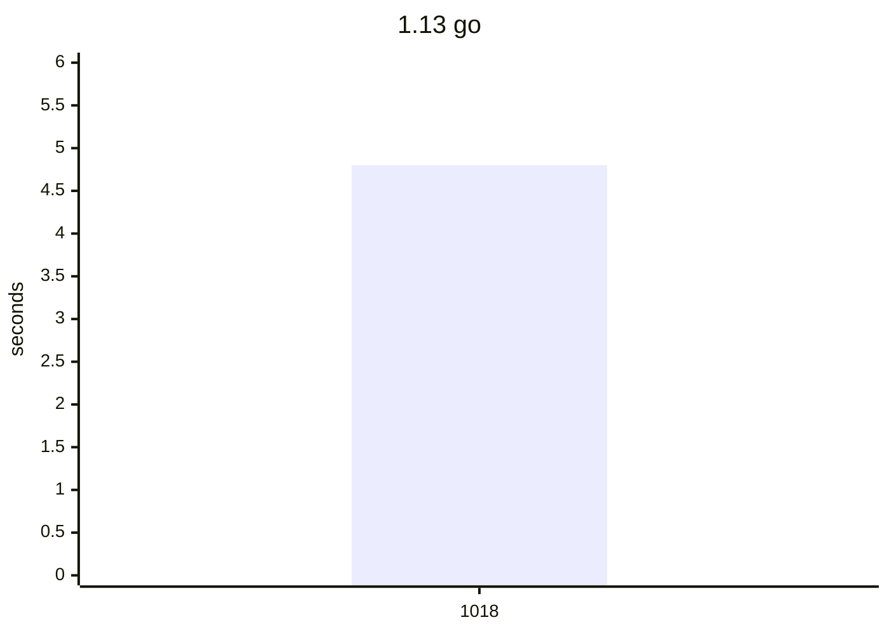
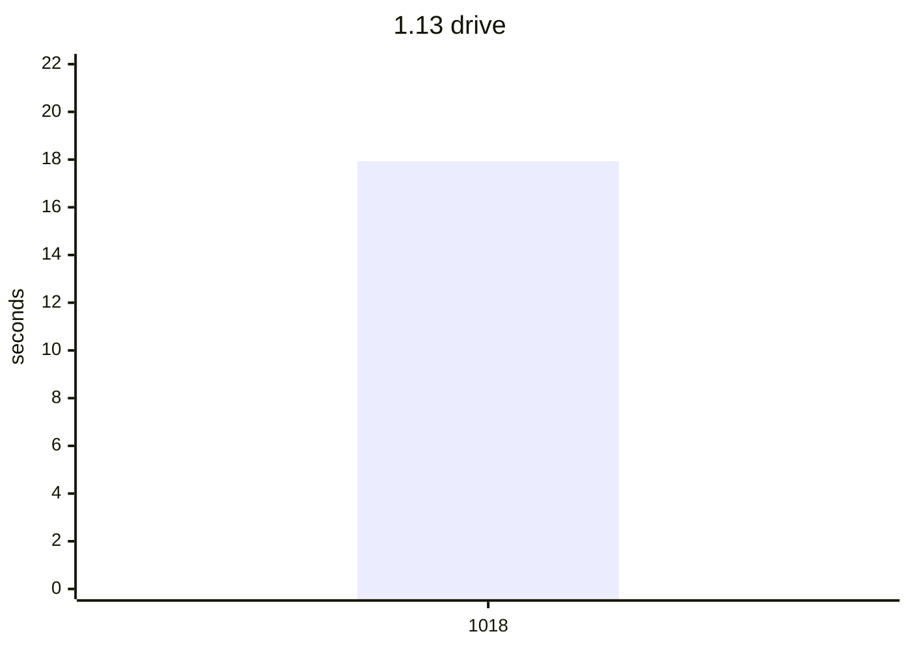

# Compile bench

Precompile time, load time, CLI wall time, `src/**/*.jl` size, and the host
(OS name, arch, CPU). `code lines` skips blank lines. A row is flagged when,
against the previous sample on the same Julia slot, the host OS or arch
changes, package precompile grows by 1.5x and 0.5s, a command wall grows
by 1.5x and 1s, or a method of at least 200 ms is new in the top 20 or
doubles. This does not fail CI.

## Flagged

No sample grew past the watch line.

## 1.13

| date | commit | version | os | arch | src files | code lines | full s | pkg s | using s | help s | go s | drive s |
| --- | --- | --- | --- | --- | --- | --- | --- | --- | --- | --- | --- | --- |
| 2026-10-17 | 1459df0 | 0.1.9 | Linux |  | 70 | 16840 | 5.8 | 2.86 | 0.31 | 1.94 |  |  |
| 2026-10-18 | e677df9 | 0.1.9 | Ubuntu 24.04.5 LTS | x86_64 | 70 | 16840 | 6.66 | 3.32 | 0.35 | 2.09 |  |  |
| 2026-10-18 | 91b44e7 | 0.1.9 | Ubuntu 24.04.5 LTS | x86_64 | 70 | 17009 | 3.88 | 1.87 | 0.2 | 0.43 | 4.8 | 17.93 |

```mermaid
xychart-beta
    title "1.13 help"
    x-axis ["1017", "1018", "1018"]
    y-axis "seconds" 0 --> 3
    line [1.94, 2.09, 0.43]
```


Latest `help` methods:

| method | now ms | previous ms |
| --- | ---: | ---: |
| `Tuple{typeof(DistSSHRun.main), Array{String, 1}}` | 49.6 | 1506.5 |
| `Tuple{typeof(DistSSHRun.print_kit_root_usage), Base.PipeEndpoint}` | 34.0 | 55.8 |
| `Tuple{Distributed.var"#start_gc_msgs_task##0#start_gc_msgs_task##1"}` | 11.6 | 18.0 |
| `Tuple{typeof(Base.should_use_main_entrypoint)}` | 9.4 | 11.3 |
| `Tuple{typeof(Base.getproperty), Base.GenericCondition{Base.ReentrantLock}, Symbol}` | 2.3 | 3.4 |
| `Tuple{typeof(Base.something), Nothing, Symbol}` | 1.9 | 2.6 |




Latest `go` methods:

| method | now ms | previous ms |
| --- | ---: | ---: |
| `Tuple{typeof(Core.kwcall), NamedTuple{(:project, :quiet, :verbosity, :yes, :sync, :args, :...` | 1953.0 |  |
| `Tuple{typeof(Main.go_main)}` | 1273.9 |  |
| `Tuple{DistSSHRun.var"#_go_run!##6#_go_run!##7"{String, String, Bool, Array{String, 1}, Not...` | 300.8 |  |
| `Tuple{DistSSHRun.var"#577#578", Array{String, 1}}` | 112.4 |  |
| `Tuple{typeof(Base.JuliaSyntax.core_parser_hook), Core.SimpleVector, String, Int64, Int64, ...` | 71.7 |  |
| `Tuple{typeof(Base.push_widen), Array{NamedTuple{(:event, :kind, :job, :label, :total, :don...` | 71.5 |  |
| `Tuple{typeof(DistSSHRun.main), Array{String, 1}}` | 50.3 |  |
| `Tuple{typeof(Core.kwcall), NamedTuple{(:ok, :footer), Tuple{Bool, String}}, typeof(DistSSH...` | 41.5 |  |
| `Tuple{typeof(Base.addenv), Base.Cmd, Pair{String, String}}` | 38.6 |  |
| `Tuple{typeof(Base.setindex!), Base.Dict{String, Symbol}, Symbol, String}` | 34.9 |  |




Latest `drive` methods:

| method | now ms | previous ms |
| --- | ---: | ---: |
| `Tuple{typeof(Core.kwcall), NamedTuple{(:original_args, :project_root), Tuple{Array{String,...` | 4993.5 |  |
| `Tuple{typeof(Main.drive_main)}` | 1662.4 |  |
| `Tuple{Distributed.var"#process_messages##0#process_messages##1"{Sockets.TCPSocket, Sockets...` | 796.9 |  |
| `Tuple{Distributed.var"#39#40"{Distributed.LocalManager, Array{Int64, 1}, Distributed.Worke...` | 591.6 |  |
| `Tuple{typeof(Serialization.serialize), Distributed.ClusterSerializer{Sockets.TCPSocket}, A...` | 311.7 |  |
| `Tuple{typeof(Base.print), Base.PipeEndpoint, Array{Int64, 1}, String}` | 184.3 |  |
| `Tuple{DistSSHRun.var"#575#576", Array{String, 1}}` | 112.9 |  |
| `Tuple{typeof(DistSSHRun.main)}` | 110.7 |  |
| `Tuple{typeof(Serialization.deserialize), Distributed.ClusterSerializer{Sockets.TCPSocket},...` | 110.3 |  |
| `Tuple{Distributed.var"#35#36"{Distributed.LocalManager, Base.GenericCondition{Base.AlwaysL...` | 95.3 |  |

## 1.14-nightly

| date | commit | version | os | arch | src files | code lines | full s | pkg s | using s | help s |
| --- | --- | --- | --- | --- | --- | --- | --- | --- | --- | --- |
| 2026-10-17 | 1459df0 | 0.1.9 | Linux |  | 70 | 16840 | 5.78 | 3.09 | 0.34 | 1.09 |
| 2026-10-18 | e677df9 | 0.1.9 | Ubuntu 24.04.5 LTS | x86_64 | 70 | 16840 | 4.6 | 2.38 | 0.31 | 0.96 |

```mermaid
xychart-beta
    title "1.14-nightly help"
    x-axis ["1017", "1018"]
    y-axis "seconds" 0 --> 2
    line [1.09, 0.96]
```


Latest `help` methods:

| method | now ms | previous ms |
| --- | ---: | ---: |
| `Tuple{typeof(DistSSHRun.main), Array{String, 1}}` | 1180.1 | 1403.4 |
| `Tuple{typeof(DistSSHRun.print_kit_root_usage), Base.PipeEndpoint}` | 48.9 |  |
| `Tuple{typeof(Distributed.flush_gc_msgs)}` | 18.2 |  |
| `Tuple{typeof(Base.should_use_main_entrypoint)}` | 12.6 | 13.2 |
| `Tuple{Distributed.var"#start_gc_msgs_task##0#start_gc_msgs_task##1"}` | 12.2 | 14.2 |
| `Tuple{typeof(Base.string), Char}` | 5.5 | 6.4 |
| `Tuple{typeof(Base.getproperty), Base.MappingRF{DistSSHRun.var"#77#78", typeof(Base.max)}, ...` | 5.4 | 5.7 |
| `Tuple{typeof(Base.getproperty), Base.MappingRF{DistSSHRun.var"#67#68", typeof(Base.max)}, ...` | 5.3 | 5.4 |
| `Tuple{typeof(Base.in), String, Tuple{String, String, String}}` | 5.2 | 5.2 |
| `Tuple{typeof(Base.getproperty), Base.Order.By{DistSSHRun.var"#_kit_progress_files##0#_kit_...` | 4.7 | 4.6 |

