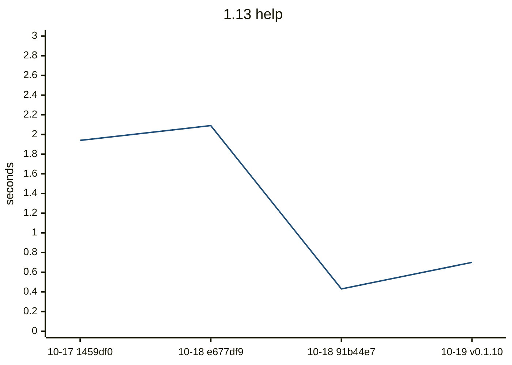
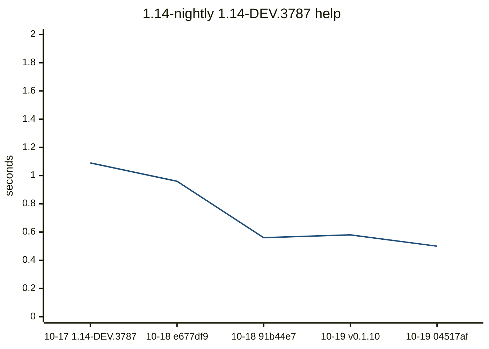
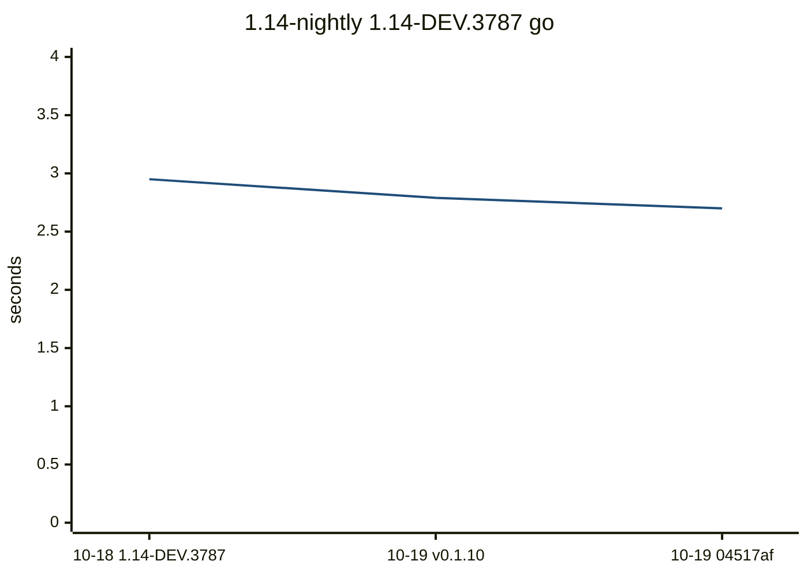
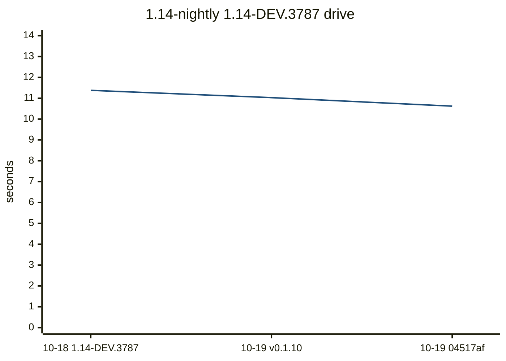
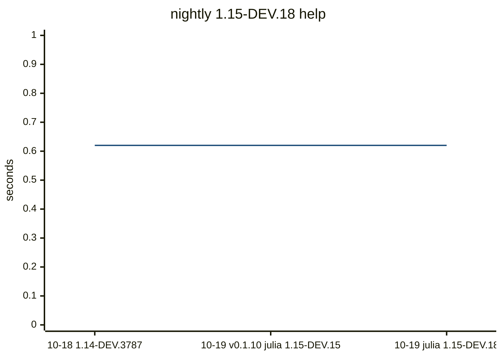
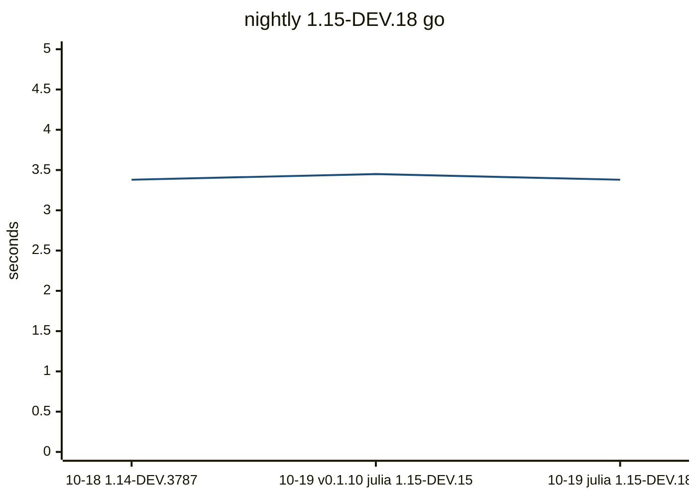
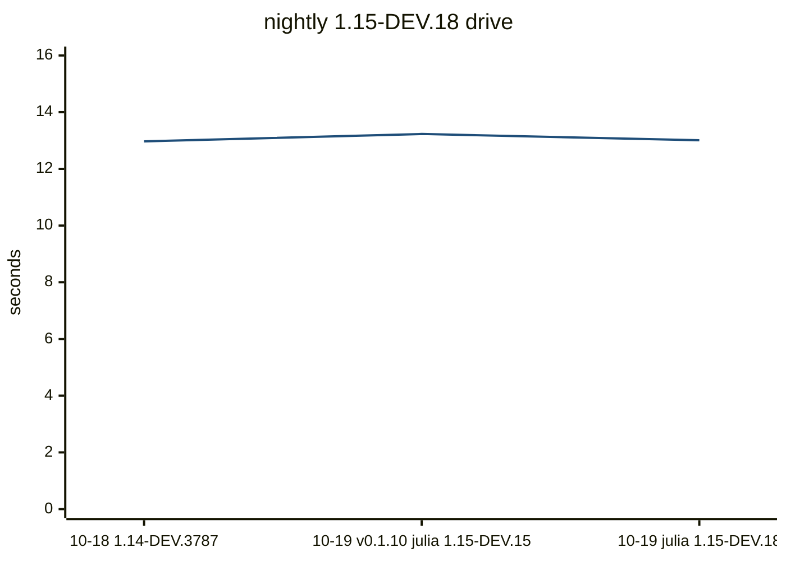

# Compile bench

Precompile time, load time, CLI wall time, `src/**/*.jl` size, and the host
(OS name, arch, CPU). `code lines` skips blank lines. A row is flagged when,
against the previous sample on the same Julia slot, the host OS or arch
changes, the Julia version changes, package precompile grows by 1.5x and 0.5s, a command wall grows
by 1.5x and 1s, or a method of at least 200 ms is new in the top 20 or
doubles. This does not fail CI.

## Flagged

- 1.13: package precompile 1.87s -> 3.56s
- 1.13: go wall 4.8s -> 8.4s
- 1.13: drive wall 17.93s -> 30.28s
- 1.13: drive method 110.3 ms -> 228.7 ms: Tuple{typeof(Serialization.deserialize), Distributed.ClusterSerializer{Sockets.TCPSocket}, Type{Core...
- nightly: julia 1.15.0-DEV.15 -> 1.15.0-DEV.18

## 1.13

| date | commit | version | julia | os | arch | src files | code lines | full s | pkg s | using s | help s | go s | drive s |
| --- | --- | --- | --- | --- | --- | --- | --- | --- | --- | --- | --- | --- | --- |
| 2026-10-17 | 1459df0 | 0.1.9 | 1.13.2 | Linux |  | 70 | 16840 | 5.8 | 2.86 | 0.31 | 1.94 |  |  |
| 2026-10-18 | e677df9 | 0.1.9 | 1.13.2 | Ubuntu 24.04.5 LTS | x86_64 | 70 | 16840 | 6.66 | 3.32 | 0.35 | 2.09 |  |  |
| 2026-10-18 | 91b44e7 | 0.1.9 | 1.13.2 | Ubuntu 24.04.5 LTS | x86_64 | 70 | 17009 | 3.88 | 1.87 | 0.2 | 0.43 | 4.8 | 17.93 |
| 2026-10-19 | 29d47fa | 0.1.10 | 1.13.2 | Ubuntu 24.04.5 LTS | x86_64 | 70 | 17009 | 7.05 | 3.56 | 0.34 | 0.7 | 8.4 | 30.28 |




Latest `help` methods:

| method | now ms | previous ms |
| --- | ---: | ---: |
| `Tuple{typeof(DistSSHRun.main), Array{String, 1}}` | 86.4 | 49.6 |
| `Tuple{typeof(DistSSHRun.print_kit_root_usage), Base.PipeEndpoint}` | 59.1 | 34.0 |
| `Tuple{Distributed.var"#start_gc_msgs_task##0#start_gc_msgs_task##1"}` | 19.0 | 11.6 |
| `Tuple{typeof(Base.should_use_main_entrypoint)}` | 11.8 | 9.4 |
| `Tuple{typeof(Base.getproperty), Base.GenericCondition{Base.ReentrantLock}, Symbol}` | 3.9 | 2.3 |
| `Tuple{typeof(Base.something), Nothing, Symbol}` | 3.2 | 1.9 |

```mermaid
---
config:
  theme: base
  themeVariables:
    xyChart:
      plotColorPalette: "#1f4e79"
  xyChart:
    xAxis:
      labelRotation: 45
---
xychart-beta
    title "1.13 go"
    x-axis ["10-18 91b44e7", "10-19 v0.1.10"]
    y-axis "seconds" 0 --> 11
    line [4.8, 8.4]
```


Latest `go` methods:

| method | now ms | previous ms |
| --- | ---: | ---: |
| `Tuple{typeof(Core.kwcall), NamedTuple{(:project, :quiet, :verbosity, :yes, :sync, :args, :...` | 3486.4 | 1953.0 |
| `Tuple{typeof(Main.go_main)}` | 2252.4 | 1273.9 |
| `Tuple{DistSSHRun.var"#_go_run!##6#_go_run!##7"{String, String, Bool, Array{String, 1}, Not...` | 527.9 | 300.8 |
| `Tuple{DistSSHRun.var"#577#578", Array{String, 1}}` | 180.4 | 112.4 |
| `Tuple{typeof(Base.push_widen), Array{NamedTuple{(:event, :kind, :job, :label, :total, :don...` | 131.0 | 71.5 |
| `Tuple{typeof(Base.JuliaSyntax.core_parser_hook), Core.SimpleVector, String, Int64, Int64, ...` | 129.9 | 71.7 |
| `Tuple{typeof(DistSSHRun.main), Array{String, 1}}` | 87.7 | 50.3 |
| `Tuple{typeof(Core.kwcall), NamedTuple{(:ok, :footer), Tuple{Bool, String}}, typeof(DistSSH...` | 73.4 | 41.5 |
| `Tuple{typeof(Base.addenv), Base.Cmd, Pair{String, String}}` | 66.9 | 38.6 |
| `Tuple{typeof(Base.setindex!), Base.Dict{String, Symbol}, Symbol, String}` | 65.1 | 34.9 |

```mermaid
---
config:
  theme: base
  themeVariables:
    xyChart:
      plotColorPalette: "#1f4e79"
  xyChart:
    xAxis:
      labelRotation: 45
---
xychart-beta
    title "1.13 drive"
    x-axis ["10-18 91b44e7", "10-19 v0.1.10"]
    y-axis "seconds" 0 --> 37
    line [17.93, 30.28]
```


Latest `drive` methods:

| method | now ms | previous ms |
| --- | ---: | ---: |
| `Tuple{typeof(Core.kwcall), NamedTuple{(:original_args, :project_root), Tuple{Array{String,...` | 8884.5 | 4993.5 |
| `Tuple{typeof(Main.drive_main)}` | 3009.5 | 1662.4 |
| `Tuple{Distributed.var"#process_messages##0#process_messages##1"{Sockets.TCPSocket, Sockets...` | 1364.9 | 796.9 |
| `Tuple{Distributed.var"#39#40"{Distributed.LocalManager, Array{Int64, 1}, Distributed.Worke...` | 1150.5 | 591.6 |
| `Tuple{typeof(Serialization.serialize), Distributed.ClusterSerializer{Sockets.TCPSocket}, A...` | 580.4 | 311.7 |
| `Tuple{typeof(Base.print), Base.PipeEndpoint, Array{Int64, 1}, String}` | 338.9 | 184.3 |
| `Tuple{typeof(Serialization.deserialize), Distributed.ClusterSerializer{Sockets.TCPSocket},...` | 228.7 | 110.3 |
| `Tuple{typeof(DistSSHRun.main)}` | 210.6 | 110.7 |
| `Tuple{DistSSHRun.var"#575#576", Array{String, 1}}` | 177.8 | 112.9 |
| `Tuple{Distributed.var"#35#36"{Distributed.LocalManager, Base.GenericCondition{Base.AlwaysL...` | 171.0 | 95.3 |

## 1.14-nightly

| date | commit | version | julia | os | arch | src files | code lines | full s | pkg s | using s | help s | go s | drive s |
| --- | --- | --- | --- | --- | --- | --- | --- | --- | --- | --- | --- | --- | --- |
| 2026-10-17 | 1459df0 | 0.1.9 | 1.14.0-DEV.3787 | Linux |  | 70 | 16840 | 5.78 | 3.09 | 0.34 | 1.09 |  |  |
| 2026-10-18 | e677df9 | 0.1.9 | 1.14.0-DEV.3787 | Ubuntu 24.04.5 LTS | x86_64 | 70 | 16840 | 4.6 | 2.38 | 0.31 | 0.96 |  |  |
| 2026-10-18 | 91b44e7 | 0.1.9 | 1.14.0-DEV.3787 | Ubuntu 24.04.5 LTS | x86_64 | 70 | 17009 | 4.9 | 2.57 | 0.32 | 0.56 | 2.95 | 11.38 |
| 2026-10-19 | 29d47fa | 0.1.10 | 1.14.0-DEV.3787 | Ubuntu 24.04.5 LTS | x86_64 | 70 | 17009 | 4.31 | 2.41 | 0.32 | 0.58 | 2.79 | 11.03 |
| 2026-10-19 | 04517af | 0.1.10 | 1.14.0-DEV.3787 | Ubuntu 24.04.5 LTS | x86_64 | 70 | 17009 | 4.48 | 2.47 | 0.28 | 0.5 | 2.7 | 10.62 |




Latest `help` methods:

| method | now ms | previous ms |
| --- | ---: | ---: |
| `Tuple{typeof(DistSSHRun.main), Array{String, 1}}` | 105.5 | 123.2 |
| `Tuple{typeof(DistSSHRun.print_kit_root_usage), Base.PipeEndpoint}` | 45.7 | 43.1 |
| `Tuple{typeof(Distributed.flush_gc_msgs)}` | 16.7 | 16.2 |
| `Tuple{Distributed.var"#start_gc_msgs_task##0#start_gc_msgs_task##1"}` | 10.7 | 11.1 |
| `Tuple{typeof(Base.should_use_main_entrypoint)}` | 10.4 | 15.7 |
| `Tuple{typeof(Base.string), Char}` | 5.5 | 7.9 |




Latest `go` methods:

| method | now ms | previous ms |
| --- | ---: | ---: |
| `Tuple{typeof(Core.kwcall), NamedTuple{(:project, :quiet, :verbosity, :yes, :sync, :args, :...` | 2490.0 | 2369.4 |
| `Tuple{typeof(Main.go_main)}` | 1845.0 | 1851.1 |
| `Tuple{DistSSHRun.var"#_go_run!##6#_go_run!##7"{String, String, Bool, Array{String, 1}, Not...` | 324.7 | 304.1 |
| `Tuple{typeof(Base.push_widen), Array{NamedTuple{(:event, :kind, :job, :label, :total, :don...` | 104.7 | 110.2 |
| `Tuple{DistSSHRun.var"#577#578", Array{String, 1}}` | 77.0 | 76.9 |
| `Tuple{typeof(DistSSHRun.main), Array{String, 1}}` | 59.7 | 80.8 |
| `Tuple{typeof(Core.kwcall), NamedTuple{(:ok, :footer), Tuple{Bool, String}}, typeof(DistSSH...` | 46.7 | 43.2 |
| `Tuple{typeof(Base.addenv), Base.Cmd, Pair{String, String}}` | 41.1 | 48.0 |
| `Tuple{typeof(Base.grow_to!), Array{NamedTuple{(:event, :kind, :job, :label, :total, :done,...` | 33.9 | 32.1 |
| `Tuple{typeof(Base.grow_to!), Array{NamedTuple{(:event, :kind, :job, :label, :total, :done,...` | 31.7 | 31.7 |




Latest `drive` methods:

| method | now ms | previous ms |
| --- | ---: | ---: |
| `Tuple{typeof(Core.kwcall), NamedTuple{(:original_args, :project_root), Tuple{Array{String,...` | 5943.6 | 5659.1 |
| `Tuple{typeof(Main.drive_main)}` | 2977.4 | 3206.4 |
| `Tuple{Distributed.var"#38#39"{Distributed.LocalManager, Array{Int64, 1}, Distributed.Worke...` | 995.3 | 738.0 |
| `Tuple{Distributed.var"#process_messages##0#process_messages##1"{Sockets.TCPSocket, Sockets...` | 776.8 | 765.9 |
| `Tuple{typeof(Serialization.serialize), Distributed.ClusterSerializer{Sockets.TCPSocket}, A...` | 354.8 | 388.0 |
| `Tuple{typeof(Distributed.send_connection_hdr), Sockets.TCPSocket, Bool}` | 224.4 | 153.2 |
| `Tuple{typeof(Distributed.read_worker_host_port), Base.PipeEndpoint}` | 193.7 | 120.0 |
| `Tuple{typeof(DistSSHRun.main)}` | 174.2 | 222.7 |
| `Tuple{typeof(Serialization.deserialize), Distributed.ClusterSerializer{Sockets.TCPSocket},...` | 172.7 | 111.4 |
| `Tuple{typeof(Base.print), Base.PipeEndpoint, Array{Int64, 1}, String}` | 137.4 | 142.6 |

## nightly

| date | commit | version | julia | os | arch | src files | code lines | full s | pkg s | using s | help s | go s | drive s |
| --- | --- | --- | --- | --- | --- | --- | --- | --- | --- | --- | --- | --- | --- |
| 2026-10-18 | 91b44e7 | 0.1.9 | 1.14.0-DEV.3787 | Ubuntu 24.04.5 LTS | x86_64 | 70 | 17009 | 6.16 | 3.18 | 0.35 | 0.62 | 3.38 | 12.97 |
| 2026-10-19 | 29d47fa | 0.1.10 | 1.15.0-DEV.15 | Ubuntu 24.04.5 LTS | x86_64 | 70 | 17009 | 5.97 | 3.19 | 0.34 | 0.62 | 3.45 | 13.23 |
| 2026-10-19 | 04517af | 0.1.10 | 1.15.0-DEV.18 | Ubuntu 24.04.5 LTS | x86_64 | 70 | 17009 | 5.9 | 3.14 | 0.33 | 0.62 | 3.38 | 13.01 |




Latest `help` methods:

| method | now ms | previous ms |
| --- | ---: | ---: |
| `Tuple{typeof(DistSSHRun.main), Array{String, 1}}` | 131.4 | 136.6 |
| `Tuple{typeof(DistSSHRun.print_kit_root_usage), Base.PipeEndpoint}` | 58.7 | 60.1 |
| `Tuple{typeof(Distributed.flush_gc_msgs)}` | 21.3 | 22.1 |
| `Tuple{typeof(Base.should_use_main_entrypoint)}` | 15.1 | 15.5 |
| `Tuple{Distributed.var"#start_gc_msgs_task##0#start_gc_msgs_task##1"}` | 13.7 | 13.9 |
| `Tuple{typeof(Base.string), Char}` | 7.0 | 8.8 |




Latest `go` methods:

| method | now ms | previous ms |
| --- | ---: | ---: |
| `Tuple{typeof(Core.kwcall), NamedTuple{(:project, :quiet, :verbosity, :yes, :sync, :args, :...` | 3246.9 | 3310.3 |
| `Tuple{typeof(Main.go_main)}` | 2307.5 | 2368.0 |
| `Tuple{DistSSHRun.var"#_go_run!##6#_go_run!##7"{String, String, Bool, Array{String, 1}, Not...` | 419.2 | 427.0 |
| `Tuple{typeof(Base.push_widen), Array{NamedTuple{(:event, :kind, :job, :label, :total, :don...` | 137.3 | 139.7 |
| `Tuple{DistSSHRun.var"#577#578", Array{String, 1}}` | 100.7 | 101.8 |
| `Tuple{typeof(DistSSHRun.main), Array{String, 1}}` | 67.0 | 72.6 |
| `Tuple{typeof(Core.kwcall), NamedTuple{(:ok, :footer), Tuple{Bool, String}}, typeof(DistSSH...` | 60.5 | 62.2 |
| `Tuple{typeof(Base.addenv), Base.Cmd, Pair{String, String}}` | 53.7 | 54.2 |
| `Tuple{typeof(Base.grow_to!), Array{NamedTuple{(:event, :kind, :job, :label, :total, :done,...` | 43.9 | 45.5 |
| `Tuple{typeof(Base.grow_to!), Array{NamedTuple{(:event, :kind, :job, :label, :total, :done,...` | 42.1 | 43.7 |




Latest `drive` methods:

| method | now ms | previous ms |
| --- | ---: | ---: |
| `Tuple{typeof(Core.kwcall), NamedTuple{(:original_args, :project_root), Tuple{Array{String,...` | 7731.0 | 7779.2 |
| `Tuple{typeof(Main.drive_main)}` | 3815.2 | 3792.6 |
| `Tuple{Distributed.var"#38#39"{Distributed.LocalManager, Array{Int64, 1}, Distributed.Worke...` | 1366.9 | 1061.0 |
| `Tuple{Distributed.var"#process_messages##0#process_messages##1"{Sockets.TCPSocket, Sockets...` | 1062.2 | 1113.9 |
| `Tuple{typeof(Serialization.serialize), Distributed.ClusterSerializer{Sockets.TCPSocket}, A...` | 770.5 | 471.4 |
| `Tuple{typeof(Distributed.send_connection_hdr), Sockets.TCPSocket, Bool}` | 312.9 | 196.6 |
| `Tuple{typeof(Distributed.read_worker_host_port), Base.PipeEndpoint}` | 263.2 | 165.6 |
| `Tuple{typeof(DistSSHRun.main)}` | 228.2 | 229.2 |
| `Tuple{Distributed.var"#remotecall_eval##0#remotecall_eval##1"{Module, Expr, Int64}}` | 225.9 | 122.3 |
| `Tuple{typeof(Base.print), Base.PipeEndpoint, Array{Int64, 1}, String}` | 176.2 | 176.3 |

