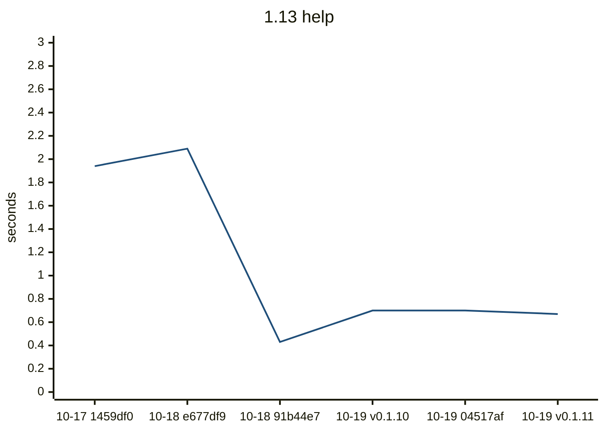
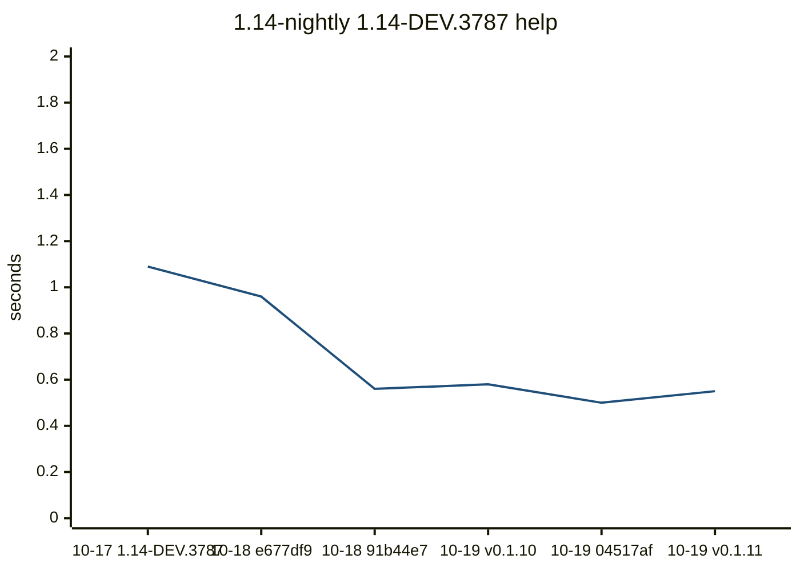
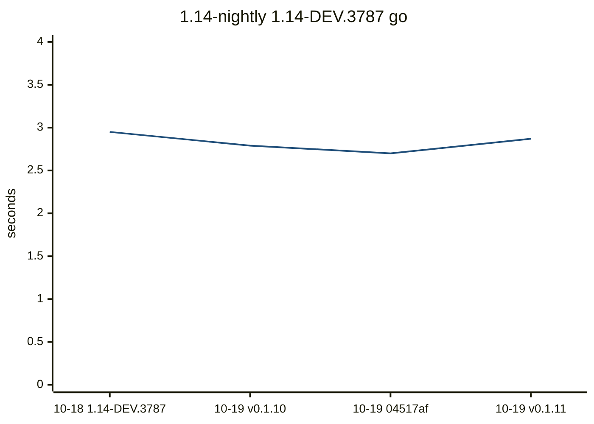
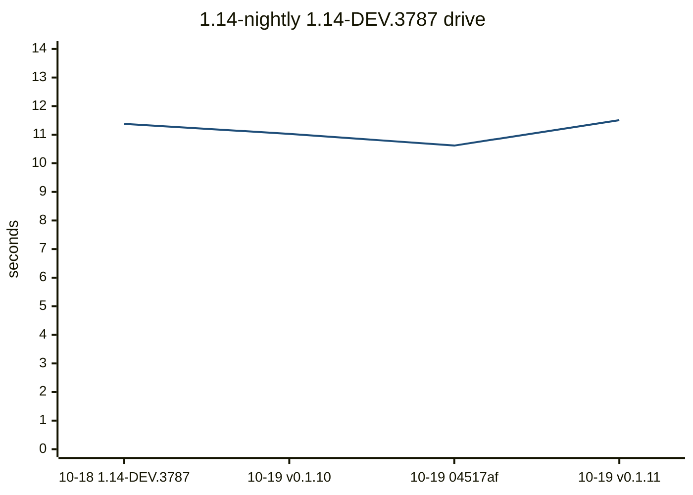
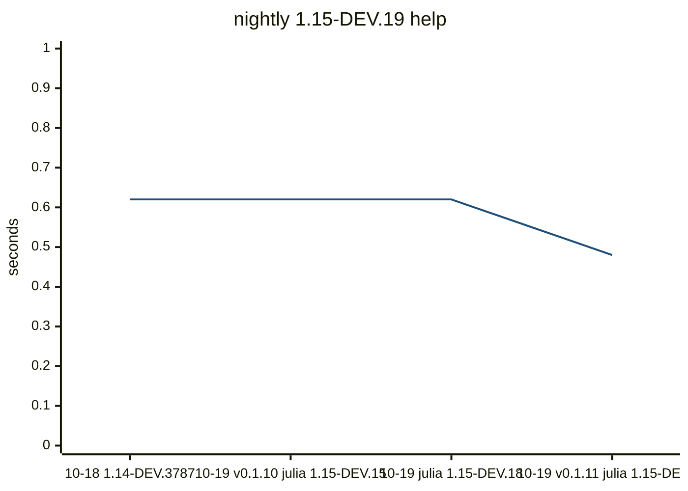
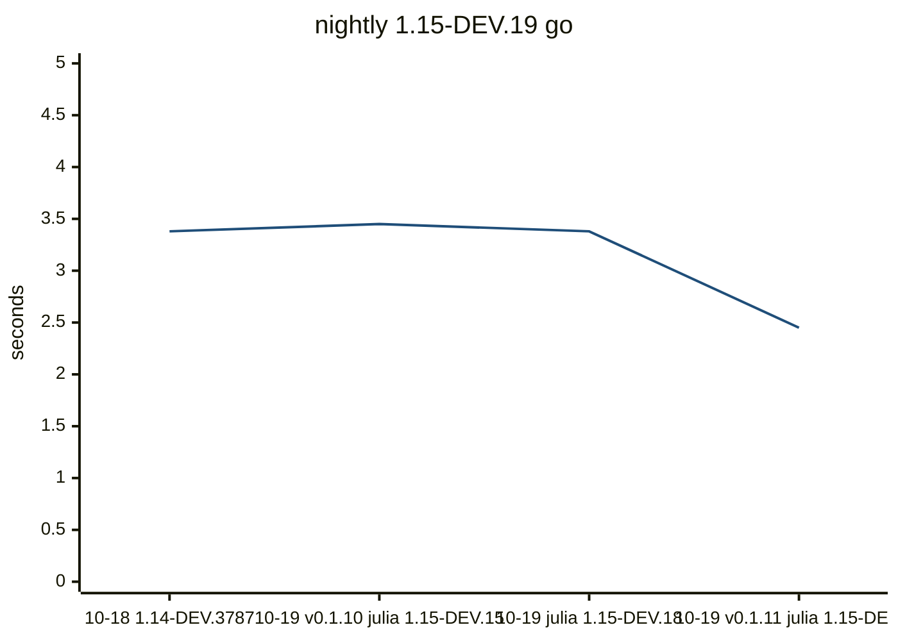
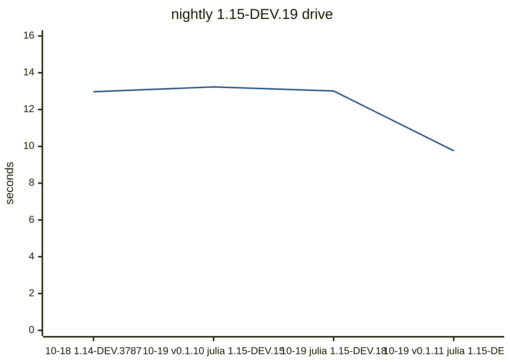

# Compile bench

Precompile time, load time, CLI wall time, `src/**/*.jl` size, and the host
(OS name, arch, CPU). `code lines` skips blank lines. A row is flagged when,
against the previous sample on the same Julia slot, the host OS or arch
changes, the Julia version changes, package precompile grows by 1.5x and 0.5s, a command wall grows
by 1.5x and 1s, or a method of at least 200 ms is new in the top 20 or
doubles. This does not fail CI.

## Flagged

- nightly: julia 1.15.0-DEV.18 -> 1.15.0-DEV.19

## 1.13

| date | commit | version | julia | os | arch | src files | code lines | full s | pkg s | using s | help s | go s | drive s |
| --- | --- | --- | --- | --- | --- | --- | --- | --- | --- | --- | --- | --- | --- |
| 2026-10-17 | 1459df0 | 0.1.9 | 1.13.2 | Linux |  | 70 | 16840 | 5.8 | 2.86 | 0.31 | 1.94 |  |  |
| 2026-10-18 | e677df9 | 0.1.9 | 1.13.2 | Ubuntu 24.04.5 LTS | x86_64 | 70 | 16840 | 6.66 | 3.32 | 0.35 | 2.09 |  |  |
| 2026-10-18 | 91b44e7 | 0.1.9 | 1.13.2 | Ubuntu 24.04.5 LTS | x86_64 | 70 | 17009 | 3.88 | 1.87 | 0.2 | 0.43 | 4.8 | 17.93 |
| 2026-10-19 | 29d47fa | 0.1.10 | 1.13.2 | Ubuntu 24.04.5 LTS | x86_64 | 70 | 17009 | 7.05 | 3.56 | 0.34 | 0.7 | 8.4 | 30.28 |
| 2026-10-19 | 04517af | 0.1.10 | 1.13.2 | Ubuntu 24.04.5 LTS | x86_64 | 70 | 17009 | 6.96 | 3.52 | 0.34 | 0.7 | 8.16 | 29.01 |
| 2026-10-19 | 51bcc51 | 0.1.11 | 1.13.2 | Ubuntu 24.04.5 LTS | x86_64 | 70 | 17009 | 6.22 | 3.1 | 0.33 | 0.67 | 7.68 | 26.63 |




Latest `help` methods:

| method | now ms | previous ms |
| --- | ---: | ---: |
| `Tuple{typeof(DistSSHRun.main), Array{String, 1}}` | 74.9 | 87.5 |
| `Tuple{typeof(DistSSHRun.print_kit_root_usage), Base.PipeEndpoint}` | 46.6 | 57.9 |
| `Tuple{Distributed.var"#start_gc_msgs_task##0#start_gc_msgs_task##1"}` | 16.5 | 19.3 |
| `Tuple{typeof(Base.should_use_main_entrypoint)}` | 11.3 | 11.6 |
| `Tuple{typeof(Base.getproperty), Base.GenericCondition{Base.ReentrantLock}, Symbol}` | 3.1 | 3.8 |
| `Tuple{typeof(Base.something), Nothing, Symbol}` | 3.1 | 3.0 |

```mermaid
---
config:
  theme: base
  themeVariables:
    xyChart:
      plotColorPalette: "#1f4e79"
  xyChart:
    xAxis:
      labelRotation: 45
---
xychart-beta
    title "1.13 go"
    x-axis ["10-18 91b44e7", "10-19 v0.1.10", "10-19 04517af", "10-19 v0.1.11"]
    y-axis "seconds" 0 --> 11
    line [4.8, 8.4, 8.16, 7.68]
```


Latest `go` methods:

| method | now ms | previous ms |
| --- | ---: | ---: |
| `Tuple{typeof(Core.kwcall), NamedTuple{(:project, :quiet, :verbosity, :yes, :sync, :args, :...` | 3094.9 | 3413.2 |
| `Tuple{typeof(Main.go_main)}` | 2098.9 | 2234.8 |
| `Tuple{DistSSHRun.var"#_go_run!##6#_go_run!##7"{String, String, Bool, Array{String, 1}, Not...` | 478.0 | 522.1 |
| `Tuple{DistSSHRun.var"#577#578", Array{String, 1}}` | 160.5 | 178.0 |
| `Tuple{typeof(Base.push_widen), Array{NamedTuple{(:event, :kind, :job, :label, :total, :don...` | 107.3 | 134.0 |
| `Tuple{typeof(Base.JuliaSyntax.core_parser_hook), Core.SimpleVector, String, Int64, Int64, ...` | 107.2 | 128.2 |
| `Tuple{typeof(DistSSHRun.main), Array{String, 1}}` | 67.0 | 84.3 |
| `Tuple{typeof(Base.addenv), Base.Cmd, Pair{String, String}}` | 59.9 | 65.9 |
| `Tuple{typeof(Core.kwcall), NamedTuple{(:ok, :footer), Tuple{Bool, String}}, typeof(DistSSH...` | 58.9 | 72.0 |
| `Tuple{typeof(Base.setindex!), Base.Dict{String, Symbol}, Symbol, String}` | 51.5 | 62.2 |

```mermaid
---
config:
  theme: base
  themeVariables:
    xyChart:
      plotColorPalette: "#1f4e79"
  xyChart:
    xAxis:
      labelRotation: 45
---
xychart-beta
    title "1.13 drive"
    x-axis ["10-18 91b44e7", "10-19 v0.1.10", "10-19 04517af", "10-19 v0.1.11"]
    y-axis "seconds" 0 --> 37
    line [17.93, 30.28, 29.01, 26.63]
```


Latest `drive` methods:

| method | now ms | previous ms |
| --- | ---: | ---: |
| `Tuple{typeof(Core.kwcall), NamedTuple{(:original_args, :project_root), Tuple{Array{String,...` | 7678.1 | 8577.0 |
| `Tuple{typeof(Main.drive_main)}` | 2811.7 | 2900.9 |
| `Tuple{Distributed.var"#process_messages##0#process_messages##1"{Sockets.TCPSocket, Sockets...` | 1280.4 | 1297.8 |
| `Tuple{Distributed.var"#39#40"{Distributed.LocalManager, Array{Int64, 1}, Distributed.Worke...` | 975.2 | 1132.7 |
| `Tuple{typeof(Serialization.serialize), Distributed.ClusterSerializer{Sockets.TCPSocket}, A...` | 481.5 | 535.2 |
| `Tuple{typeof(Base.print), Base.PipeEndpoint, Array{Int64, 1}, String}` | 278.6 | 329.8 |
| `Tuple{Distributed.var"#35#36"{Distributed.LocalManager, Base.GenericCondition{Base.AlwaysL...` | 240.1 | 167.3 |
| `Tuple{typeof(Serialization.deserialize), Distributed.ClusterSerializer{Sockets.TCPSocket},...` | 184.5 | 231.3 |
| `Tuple{typeof(DistSSHRun.main)}` | 180.7 | 199.7 |
| `Tuple{DistSSHRun.var"#575#576", Array{String, 1}}` | 176.8 | 178.3 |

## 1.14-nightly

| date | commit | version | julia | os | arch | src files | code lines | full s | pkg s | using s | help s | go s | drive s |
| --- | --- | --- | --- | --- | --- | --- | --- | --- | --- | --- | --- | --- | --- |
| 2026-10-17 | 1459df0 | 0.1.9 | 1.14.0-DEV.3787 | Linux |  | 70 | 16840 | 5.78 | 3.09 | 0.34 | 1.09 |  |  |
| 2026-10-18 | e677df9 | 0.1.9 | 1.14.0-DEV.3787 | Ubuntu 24.04.5 LTS | x86_64 | 70 | 16840 | 4.6 | 2.38 | 0.31 | 0.96 |  |  |
| 2026-10-18 | 91b44e7 | 0.1.9 | 1.14.0-DEV.3787 | Ubuntu 24.04.5 LTS | x86_64 | 70 | 17009 | 4.9 | 2.57 | 0.32 | 0.56 | 2.95 | 11.38 |
| 2026-10-19 | 29d47fa | 0.1.10 | 1.14.0-DEV.3787 | Ubuntu 24.04.5 LTS | x86_64 | 70 | 17009 | 4.31 | 2.41 | 0.32 | 0.58 | 2.79 | 11.03 |
| 2026-10-19 | 04517af | 0.1.10 | 1.14.0-DEV.3787 | Ubuntu 24.04.5 LTS | x86_64 | 70 | 17009 | 4.48 | 2.47 | 0.28 | 0.5 | 2.7 | 10.62 |
| 2026-10-19 | 51bcc51 | 0.1.11 | 1.14.0-DEV.3787 | Ubuntu 24.04.5 LTS | x86_64 | 70 | 17009 | 4.79 | 2.52 | 0.3 | 0.55 | 2.87 | 11.51 |




Latest `help` methods:

| method | now ms | previous ms |
| --- | ---: | ---: |
| `Tuple{typeof(DistSSHRun.main), Array{String, 1}}` | 115.7 | 105.5 |
| `Tuple{typeof(DistSSHRun.print_kit_root_usage), Base.PipeEndpoint}` | 48.8 | 45.7 |
| `Tuple{typeof(Distributed.flush_gc_msgs)}` | 19.3 | 16.7 |
| `Tuple{Distributed.var"#start_gc_msgs_task##0#start_gc_msgs_task##1"}` | 12.4 | 10.7 |
| `Tuple{typeof(Base.should_use_main_entrypoint)}` | 11.7 | 10.4 |
| `Tuple{typeof(Base.string), Char}` | 6.4 | 5.5 |




Latest `go` methods:

| method | now ms | previous ms |
| --- | ---: | ---: |
| `Tuple{typeof(Core.kwcall), NamedTuple{(:project, :quiet, :verbosity, :yes, :sync, :args, :...` | 2704.9 | 2490.0 |
| `Tuple{typeof(Main.go_main)}` | 2011.6 | 1845.0 |
| `Tuple{DistSSHRun.var"#_go_run!##6#_go_run!##7"{String, String, Bool, Array{String, 1}, Not...` | 350.6 | 324.7 |
| `Tuple{typeof(Base.push_widen), Array{NamedTuple{(:event, :kind, :job, :label, :total, :don...` | 111.1 | 104.7 |
| `Tuple{DistSSHRun.var"#577#578", Array{String, 1}}` | 80.6 | 77.0 |
| `Tuple{typeof(DistSSHRun.main), Array{String, 1}}` | 68.4 | 59.7 |
| `Tuple{typeof(Core.kwcall), NamedTuple{(:ok, :footer), Tuple{Bool, String}}, typeof(DistSSH...` | 50.3 | 46.7 |
| `Tuple{typeof(Base.addenv), Base.Cmd, Pair{String, String}}` | 44.8 | 41.1 |
| `Tuple{typeof(Base.grow_to!), Array{NamedTuple{(:event, :kind, :job, :label, :total, :done,...` | 35.4 | 33.9 |
| `Tuple{typeof(Base.grow_to!), Array{NamedTuple{(:event, :kind, :job, :label, :total, :done,...` | 33.9 | 31.7 |




Latest `drive` methods:

| method | now ms | previous ms |
| --- | ---: | ---: |
| `Tuple{typeof(Core.kwcall), NamedTuple{(:original_args, :project_root), Tuple{Array{String,...` | 6937.8 | 5943.6 |
| `Tuple{typeof(Main.drive_main)}` | 3326.1 | 2977.4 |
| `Tuple{Distributed.var"#38#39"{Distributed.LocalManager, Array{Int64, 1}, Distributed.Worke...` | 1119.9 | 995.3 |
| `Tuple{Distributed.var"#process_messages##0#process_messages##1"{Sockets.TCPSocket, Sockets...` | 919.4 | 776.8 |
| `Tuple{typeof(Serialization.serialize), Distributed.ClusterSerializer{Sockets.TCPSocket}, A...` | 422.9 | 354.8 |
| `Tuple{typeof(DistSSHRun.main)}` | 249.2 | 174.2 |
| `Tuple{typeof(Distributed.send_connection_hdr), Sockets.TCPSocket, Bool}` | 246.4 | 224.4 |
| `Tuple{typeof(Distributed.read_worker_host_port), Base.PipeEndpoint}` | 213.0 | 193.7 |
| `Tuple{typeof(Base.push_widen), Array{NamedTuple{(:event, :kind, :job, :label, :total, :don...` | 150.2 | 107.0 |
| `Tuple{typeof(Base.print), Base.PipeEndpoint, Array{Int64, 1}, String}` | 147.5 | 137.4 |

## nightly

| date | commit | version | julia | os | arch | src files | code lines | full s | pkg s | using s | help s | go s | drive s |
| --- | --- | --- | --- | --- | --- | --- | --- | --- | --- | --- | --- | --- | --- |
| 2026-10-18 | 91b44e7 | 0.1.9 | 1.14.0-DEV.3787 | Ubuntu 24.04.5 LTS | x86_64 | 70 | 17009 | 6.16 | 3.18 | 0.35 | 0.62 | 3.38 | 12.97 |
| 2026-10-19 | 29d47fa | 0.1.10 | 1.15.0-DEV.15 | Ubuntu 24.04.5 LTS | x86_64 | 70 | 17009 | 5.97 | 3.19 | 0.34 | 0.62 | 3.45 | 13.23 |
| 2026-10-19 | 04517af | 0.1.10 | 1.15.0-DEV.18 | Ubuntu 24.04.5 LTS | x86_64 | 70 | 17009 | 5.9 | 3.14 | 0.33 | 0.62 | 3.38 | 13.01 |
| 2026-10-19 | 51bcc51 | 0.1.11 | 1.15.0-DEV.19 | Ubuntu 24.04.5 LTS | x86_64 | 70 | 17009 | 4.21 | 2.06 | 0.25 | 0.48 | 2.45 | 9.76 |




Latest `help` methods:

| method | now ms | previous ms |
| --- | ---: | ---: |
| `Tuple{typeof(DistSSHRun.main), Array{String, 1}}` | 105.8 | 131.4 |
| `Tuple{typeof(DistSSHRun.print_kit_root_usage), Base.PipeEndpoint}` | 43.6 | 58.7 |
| `Tuple{typeof(Distributed.flush_gc_msgs)}` | 16.9 | 21.3 |
| `Tuple{typeof(Base.should_use_main_entrypoint)}` | 11.9 | 15.1 |
| `Tuple{Distributed.var"#start_gc_msgs_task##0#start_gc_msgs_task##1"}` | 11.6 | 13.7 |
| `Tuple{typeof(Base.string), Char}` | 6.6 | 7.0 |




Latest `go` methods:

| method | now ms | previous ms |
| --- | ---: | ---: |
| `Tuple{typeof(Core.kwcall), NamedTuple{(:project, :quiet, :verbosity, :yes, :sync, :args, :...` | 2347.1 | 3246.9 |
| `Tuple{typeof(Main.go_main)}` | 1671.1 | 2307.5 |
| `Tuple{DistSSHRun.var"#_go_run!##6#_go_run!##7"{String, String, Bool, Array{String, 1}, Not...` | 296.4 | 419.2 |
| `Tuple{typeof(Base.push_widen), Array{NamedTuple{(:event, :kind, :job, :label, :total, :don...` | 99.2 | 137.3 |
| `Tuple{DistSSHRun.var"#577#578", Array{String, 1}}` | 79.7 | 100.7 |
| `Tuple{typeof(DistSSHRun.main), Array{String, 1}}` | 60.4 | 67.0 |
| `Tuple{typeof(Core.kwcall), NamedTuple{(:ok, :footer), Tuple{Bool, String}}, typeof(DistSSH...` | 44.8 | 60.5 |
| `Tuple{typeof(Base.addenv), Base.Cmd, Pair{String, String}}` | 40.5 | 53.7 |
| `Tuple{typeof(Base.grow_to!), Array{NamedTuple{(:event, :kind, :job, :label, :total, :done,...` | 31.7 | 42.1 |
| `Tuple{typeof(Base.grow_to!), Array{NamedTuple{(:event, :kind, :job, :label, :total, :done,...` | 31.4 | 43.9 |




Latest `drive` methods:

| method | now ms | previous ms |
| --- | ---: | ---: |
| `Tuple{typeof(Core.kwcall), NamedTuple{(:original_args, :project_root), Tuple{Array{String,...` | 5694.7 | 7731.0 |
| `Tuple{typeof(Main.drive_main)}` | 2715.2 | 3815.2 |
| `Tuple{Distributed.var"#38#39"{Distributed.LocalManager, Array{Int64, 1}, Distributed.Worke...` | 920.4 | 1366.9 |
| `Tuple{Distributed.var"#process_messages##0#process_messages##1"{Sockets.TCPSocket, Sockets...` | 701.1 | 1062.2 |
| `Tuple{typeof(Serialization.serialize), Distributed.ClusterSerializer{Sockets.TCPSocket}, A...` | 320.0 | 770.5 |
| `Tuple{typeof(Distributed.send_connection_hdr), Sockets.TCPSocket, Bool}` | 214.9 | 312.9 |
| `Tuple{typeof(DistSSHRun.main)}` | 209.9 | 228.2 |
| `Tuple{typeof(Distributed.read_worker_host_port), Base.PipeEndpoint}` | 170.1 | 263.2 |
| `Tuple{typeof(Base.print), Base.PipeEndpoint, Array{Int64, 1}, String}` | 123.0 | 176.2 |
| `Tuple{typeof(Serialization.deserialize), Distributed.ClusterSerializer{Sockets.TCPSocket},...` | 106.6 | 158.0 |

