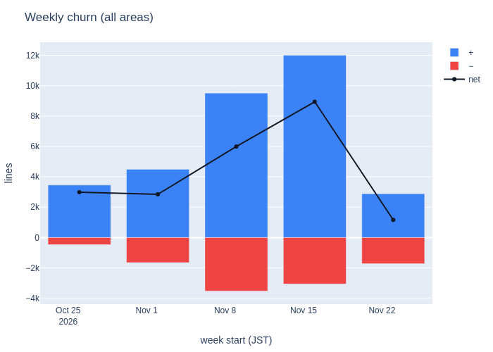

## Source churn

Lines are non-blank `*.jl` under `src/` and `lib/*/src/`, grouped by package and area.
Columns use git history through `dce65d1` as of 2026-11-28 (JST).
Areas list only directories that hold at least one `*.jl` directly and show any 7d or 30d added/deleted lines.

**(root files)** lists `.jl` files sitting directly in a package `src/` directory, not in a subfolder.

Interactive charts (hover for values): [summary](charts/churn-summary.html) · [weekly](charts/churn-weekly.html) · [heatmap](charts/churn-heatmap.html).

### DistSSHBase
| area | files | LOC | +7d | −7d | net7 | +30d | −30d | net30 | %≥30d old | last touch |
| --- | ---: | ---: | ---: | ---: | ---: | ---: | ---: | ---: | ---: | --- |
| ssh/ | 9 | 2269 | 171 | 103 | 68 | 1136 | 348 | 788 | 61.2 | 2026-11-24 |
| hosts/ | 6 | 1097 | 19 | 13 | 6 | 1062 | 220 | 842 | 21.8 | 2026-11-24 |
| (root files) | 7 | 453 | 324 | 6 | 318 | 426 | 14 | 412 | 15.6 | 2026-11-24 |
| procs/ | 3 | 275 | 299 | 5 | 294 | 299 | 5 | 294 | 0.0 | 2026-11-24 |
| messages/ | 4 | 403 | 30 | 4 | 26 | 191 | 65 | 126 | 61.9 | 2026-11-22 |
| DistSSHBase.jl | 1 | 91 | 21 | 0 | 21 | 90 | 32 | 58 | 24.5 | 2026-11-24 |
| argv/ | 1 | 31 | 0 | 0 | 0 | 1 | 1 | 0 | 97.4 | 2026-11-08 |

*(root files)*: cli.jl, component_id.jl, component_src.jl, env.jl, namespace.jl, record_writer.jl, tool_require.jl.

### DistSSHHeartbeat
| area | files | LOC | +7d | −7d | net7 | +30d | −30d | net30 | %≥30d old | last touch |
| --- | ---: | ---: | ---: | ---: | ---: | ---: | ---: | ---: | ---: | --- |
| (root files) | 5 | 204 | 16 | 10 | 6 | 248 | 25 | 223 | 0.0 | 2026-11-24 |
| DistSSHHeartbeat.jl | 1 | 22 | 0 | 0 | 0 | 30 | 2 | 28 | 0.0 | 2026-11-13 |

*(root files)*: config.jl, deliver.jl, monitor.jl, worker.jl, worker_source.jl.

### DistSSHRun
| area | files | LOC | +7d | −7d | net7 | +30d | −30d | net30 | %≥30d old | last touch |
| --- | ---: | ---: | ---: | ---: | ---: | ---: | ---: | ---: | ---: | --- |
| infra/ | 26 | 10482 | 1531 | 508 | 1023 | 11234 | 2516 | 8718 | 21.2 | 2026-11-24 |
| (root files) | 11 | 5555 | 660 | 653 | 7 | 3760 | 1874 | 1886 | 52.6 | 2026-11-24 |
| core/drive/ | 12 | 3450 | 511 | 270 | 241 | 2115 | 1207 | 908 | 61.1 | 2026-11-24 |
| argv/ | 8 | 2525 | 210 | 137 | 73 | 2002 | 998 | 1004 | 44.2 | 2026-11-24 |
| core/setup/ | 10 | 4358 | 555 | 160 | 395 | 2392 | 475 | 1917 | 53.0 | 2026-11-24 |
| drive/ | 7 | 2160 | 550 | 309 | 241 | 1341 | 997 | 344 | 65.5 | 2026-11-23 |
| options/ | 9 | 1206 | 273 | 47 | 226 | 1314 | 132 | 1182 | 6.3 | 2026-11-23 |
| cli/ | 15 | 1157 | 41 | 40 | 1 | 712 | 474 | 238 | 62.7 | 2026-11-24 |
| messages/ | 3 | 2632 | 139 | 226 | -87 | 783 | 362 | 421 | 76.2 | 2026-11-24 |
| DistSSHRun.jl | 1 | 560 | 65 | 45 | 20 | 290 | 209 | 81 | 66.5 | 2026-11-24 |
| core/ | 1 | 172 | 43 | 26 | 17 | 214 | 28 | 186 | 0.0 | 2026-11-23 |

*(root files)*: DistSSHRun/drive.jl, DistSSHRun/execute.jl, DistSSHRun/execute_envelope.jl, DistSSHRun/go.jl, DistSSHRun/heartbeat_module.jl, DistSSHRun/hostinfo.jl, DistSSHRun/pool.jl, DistSSHRun/provenance.jl, DistSSHRun/setup.jl, DistSSHRun/ship_module.jl, DistSSHRun/up_module.jl.

### DistSSHShip
| area | files | LOC | +7d | −7d | net7 | +30d | −30d | net30 | %≥30d old | last touch |
| --- | ---: | ---: | ---: | ---: | ---: | ---: | ---: | ---: | ---: | --- |
| (root files) | 8 | 2075 | 119 | 32 | 87 | 2572 | 356 | 2216 | 0.0 | 2026-11-24 |
| DistSSHShip.jl | 1 | 56 | 1 | 0 | 1 | 89 | 26 | 63 | 0.0 | 2026-11-24 |

*(root files)*: contain.jl, deps.jl, pack.jl, project.jl, record.jl, select.jl, ship.jl, tree_manifest.jl.

### DistSSHUp
| area | files | LOC | +7d | −7d | net7 | +30d | −30d | net30 | %≥30d old | last touch |
| --- | ---: | ---: | ---: | ---: | ---: | ---: | ---: | ---: | ---: | --- |
| (root files) | 6 | 602 | 0 | 0 | 0 | 48 | 52 | -4 | 92.9 | 2026-11-07 |

*(root files)*: body.jl, hosts.jl, local.jl, remote.jl, status.jl, version.jl.

### Removed paths
Paths with churn in the window but no file at HEAD.
| package | path | +30d | −30d | last touch |
| --- | --- | ---: | ---: | --- |
| DistSSHSize | `lib/DistSSHSize/src/DistSSHSize.jl` | 14 | 14 | 2026-11-08 |
| DistSSHSize | `lib/DistSSHSize/src/body.jl` | 12 | 12 | 2026-11-08 |
| DistSSHSize | `lib/DistSSHSize/src/compute_worker_plan.jl` | 45 | 45 | 2026-11-08 |
| DistSSHSize | `lib/DistSSHSize/src/worker_plan.jl` | 114 | 114 | 2026-11-08 |
| DistSSHRun | `src/DistSSHRun/argv/plan_args.jl` | 1 | 136 | 2026-11-06 |
| DistSSHRun | `src/DistSSHRun/argv/ride_args.jl` | 107 | 272 | 2026-11-21 |
| DistSSHRun | `src/DistSSHRun/argv/size_args.jl` | 0 | 148 | 2026-11-08 |
| DistSSHRun | `src/DistSSHRun/argv/size_report.jl` | 0 | 134 | 2026-11-08 |
| DistSSHRun | `src/DistSSHRun/drive/runtime/heartbeat.jl` | 0 | 49 | 2026-11-09 |
| DistSSHRun | `src/DistSSHRun/drive/size.jl` | 1 | 113 | 2026-11-08 |
| DistSSHRun | `src/DistSSHRun/infra/script_scan.jl` | 315 | 315 | 2026-11-21 |
| DistSSHRun | `src/DistSSHRun/plan.jl` | 201 | 683 | 2026-11-06 |
| DistSSHRun | `src/DistSSHRun/ride.jl` | 351 | 1135 | 2026-11-21 |
| DistSSHRun | `src/DistSSHRun/size/measure.jl` | 0 | 247 | 2026-11-08 |
| DistSSHRun | `src/DistSSHRun/size_module.jl` | 18 | 18 | 2026-11-08 |
| DistSSHRun | `src/cli/plan.jl` | 0 | 68 | 2026-11-06 |
| DistSSHRun | `src/cli/plan/_using.jl` | 0 | 6 | 2026-11-06 |
| DistSSHRun | `src/cli/ride.jl` | 84 | 162 | 2026-11-21 |
| DistSSHRun | `src/cli/ride/_using.jl` | 0 | 9 | 2026-11-21 |
| DistSSHRun | `src/cli/size/_using.jl` | 0 | 9 | 2026-11-08 |